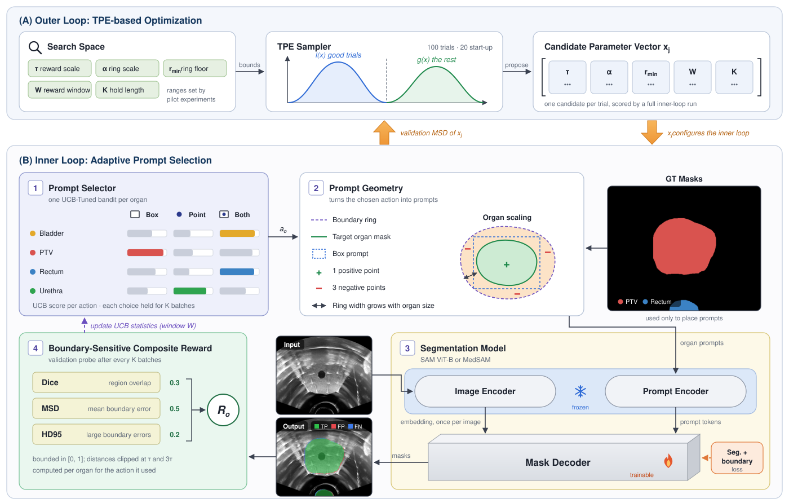
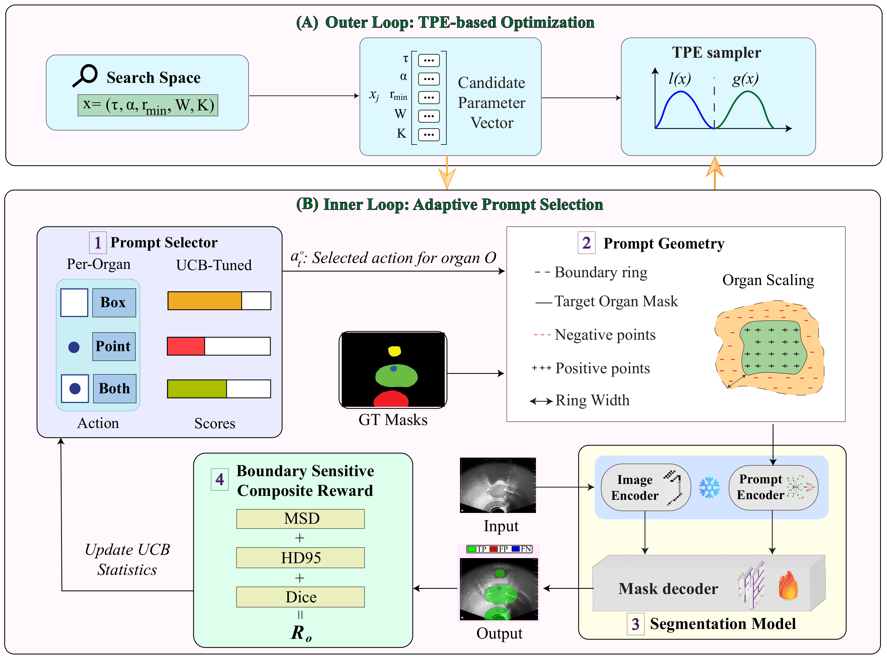

<div align="center">

# BAP-MOS

**Bandit-Based Adaptive Prompting for Boundary-Sensitive Multi-Organ Segmentation**

Satvik Praveen, Shengji Jin, Ahmed Lamidi, Xin Qian, Yi Sheng

[](https://arxiv.org/abs/2608.08191)
[](LICENSE)
[](requirements.txt)
[](requirements.txt)

</div>

## Overview

BAP-MOS is a bandit-based adaptive prompting framework for boundary-sensitive multi-organ ultrasound segmentation. It dynamically selects prompting strategies based on organ-specific segmentation performance, enabling adaptive prompt allocation without modifying the foundation-model backbone.

The framework is evaluated on prostate TRUS and bladder PFUS ultrasound datasets using SAM/MedSAM-based segmentation backbones.

<p align="center">
  
</p>

**(A)** An outer TPE loop searches the prompt-selection parameters (τ, α, r<sub>min</sub>, W, K). **(B)** For each candidate, the inner loop fine-tunes only the mask decoder: **(1)** a UCB-Tuned bandit per organ selects a box, point or combined prompt, **(2)** the prompt is built with an organ-scaled negative ring, **(3)** the frozen SAM/MedSAM encoders feed the trainable mask decoder, and **(4)** a Dice–MSD–HD95 reward on a validation probe updates each organ's bandit. Images show a phantom TRUS test slice and the BAP-MOS (SAM) prediction.

<details>
<summary>Framework figure from the paper</summary>



</details>

## Main results

Mean ± std over three training seeds (42, 43, 44). Prostate distances (MSD, HD95) are in millimetres; PFUS1 distances are in pixel-equivalent units. Per-seed outputs and the collation procedure are in [`docs/RESULTS.md`](docs/RESULTS.md).

### Prostate TRUS (pooled test)

| Method               | Dice ↑            | HD95 (mm) ↓       | MSD (mm) ↓        |
| -------------------- | ----------------- | ----------------- | ----------------- |
| nnU-Net              | 0.962 ± 0.002     | 1.113 ± 0.131     | 0.432 ± 0.035     |
| U-Net                | 0.965 ± 0.004     | 0.932 ± 0.158     | 0.369 ± 0.045     |
| SAM                  | 0.981 ± 0.002     | 0.527 ± 0.062     | 0.221 ± 0.001     |
| MedSAM               | 0.941 ± 0.002     | 2.736 ± 0.725     | 0.868 ± 0.100     |
| **BAP-MOS (SAM)**    | **0.982 ± 0.001** | **0.482 ± 0.016** | **0.204 ± 0.023** |
| **BAP-MOS (MedSAM)** | **0.979 ± 0.006** | **0.577 ± 0.032** | **0.229 ± 0.013** |

### External bladder PFUS1 generalization

| Method               | Dice ↑            | HD95 (px) ↓       | MSD (px) ↓        |
| -------------------- | ----------------- | ----------------- | ----------------- |
| FPN                  | 0.710             | —                 | —                 |
| **BAP-MOS (MedSAM)** | **0.849 ± 0.007** | **10.062 ± 0.55** | **5.034 ± 0.015** |

Every method is scored on the native grid of the reference annotation with the dataset's physical pixel spacing; see [Evaluation grid](docs/RESULTS.md#evaluation-grid).

## Installation

Python 3.10 or 3.11. The requirement files pin the full stack; there is no package install, and modules run from the repository root with `src/` on `PYTHONPATH`.

```bash
git clone https://github.com/SatvikPraveen/BAP-MOS.git
cd BAP-MOS

pip install -r requirements.txt        # core: training, preprocessing, inference
pip install -r requirements-hpo.txt    # Optuna, for the outer TPE loop
pip install -r requirements_dev.txt    # pytest and notebook extras (optional)

export PYTHONPATH="$(pwd)/src${PYTHONPATH:+:$PYTHONPATH}"   # scripts/bapmos.sh sets this for you
```

On a GPU cluster, install `torch` and `torchvision` for your CUDA version first (see the header of [`requirements.txt`](requirements.txt)). The nnU-Net baseline uses a separate environment: [`requirements_nnunet.txt`](requirements_nnunet.txt).

## Pretrained checkpoints

| Model        | Source                                                                             | Place at                                 |
| ------------ | ---------------------------------------------------------------------------------- | ---------------------------------------- |
| SAM ViT-B    | [sam_vit_b_01ec64.pth](https://dl.fbaipublicfiles.com/segment_anything/sam_vit_b_01ec64.pth) | `models/sam_base/sam_vit_b_01ec64.pth`   |
| MedSAM ViT-B | [medsam_vit_b.pth](https://zenodo.org/records/10689643/files/medsam_vit_b.pth)     | `models/medsam/medsam_vit_b.pth`         |

```bash
mkdir -p models/sam_base models/medsam
curl -L -o models/sam_base/sam_vit_b_01ec64.pth https://dl.fbaipublicfiles.com/segment_anything/sam_vit_b_01ec64.pth
curl -L -o models/medsam/medsam_vit_b.pth https://zenodo.org/records/10689643/files/medsam_vit_b.pth
```

The weights are not redistributed here; see [`docs/WEIGHTS.md`](docs/WEIGHTS.md).

## Data

BAP-MOS is evaluated on **prostate TRUS** (a phantom simulation and two clinical cohorts, pooled) and **bladder PFUS1** ([Solís-Martín et al., 2025](https://www.cs.us.es/~dsolis/en/pfus1.html)). Neither dataset is redistributed. Build or link them into:

```text
data/prostate/pooled/    pooled prostate TRUS
data/bladder/pfus1/      PFUS1
```

Preparation steps are in [`docs/PREPROCESS.md`](docs/PREPROCESS.md) and the README files under [`data/`](data/).

## Reproducing the results

Each step runs from the repository root. Commands are shown for pooled prostate; [`docs/RUNNING.md`](docs/RUNNING.md) has the full command ladder, including PFUS1.

**1. Preprocess**

```bash
./scripts/bapmos.sh preprocess-prostate --dry-run
./scripts/bapmos.sh preprocess-bladder --dry-run
```

**2. Outer loop: TPE search** (ranked by fold-balanced validation MSD)

```bash
# One trial as a smoke test; the full budget is in experiments/prostate/bapmos/outer_loop/tpe/
python -m bapmos.hpo.study_runner run --hpo-suite bapmos_bo --dataset pooled --n-trials 1
```

**3. Inner loop: train BAP-MOS** with the exported parameters, for each of the three seeds ([`docs/SEEDS.md`](docs/SEEDS.md))

```bash
python -m bapmos.method.bap_mos_trainer --version bapmos --dataset pooled --experiment pooled_seed42
```

Always pass `--version` and `--dataset` so the selected parameters are merged ([`docs/INNER_OUTER_LOOP.md`](docs/INNER_OUTER_LOOP.md)).

**4. Baselines**, also with three seeds (example: U-Net)

```bash
python -m bapmos.external_baselines.unet.train_multiclass --data_root data/prostate/pooled --seed 42 --run_name pooled_seed42
```

**5. Test export and result tables**

```bash
python -m bapmos.method.run_test_inference --help
bash scripts/populate_results_prostate.sh
```

Run artifacts (`runs/`, `inference_output/`, W&B logs, Optuna databases) are created locally and are not committed.

## Repository structure

```text
BAP-MOS/
├── assets/                  # Figures
├── configs/                 # Shared protocol and dataset configurations
├── experiments/             # Paper experiment definitions, selected parameters, ablations
├── src/bapmos/
│   ├── method/              # BAP-MOS trainer, bandit, prompt geometry, reward
│   ├── hpo/                 # Outer-loop TPE and search baselines
│   ├── losses/              # Decoder training losses
│   ├── metrics/             # Evaluation grid, validation and checkpoint metrics
│   ├── inference_output/    # Test-split export (metrics, predictions, panels)
│   ├── external_baselines/  # U-Net, nnU-Net, MedSAM baselines
│   ├── preprocess/          # Prostate, bladder and delineation preprocessing
│   ├── results/             # Result collation
│   └── legacy/              # Fixed-schedule and policy ablations
├── scripts/                 # Execution helpers
├── docs/                    # Reproduction and experiment documentation
├── tests/                   # Unit and smoke tests (pytest)
├── data/                    # Dataset placeholders; data not distributed
├── models/                  # SAM / MedSAM checkpoint locations
└── results/                 # Collated result tables
```

## Documentation

- Training protocol and the two loops: [`docs/INNER_OUTER_LOOP.md`](docs/INNER_OUTER_LOOP.md)
- Experiment ladder and search ablations: [`docs/EXPERIMENT_LADDER.md`](docs/EXPERIMENT_LADDER.md), [`docs/SEARCH_METHODS.md`](docs/SEARCH_METHODS.md)
- Inference, evaluation grid and result tables: [`docs/RESULTS.md`](docs/RESULTS.md)
- Runtime artifact layout: [`docs/RUNTIME_LAYOUT.md`](docs/RUNTIME_LAYOUT.md)

## Citation

If you find BAP-MOS useful in your research, please cite:

```bibtex
@misc{praveen2026bapmosbanditbasedadaptiveprompting,
      title={BAP-MOS: Bandit-Based Adaptive Prompting for Boundary-Sensitive Multi-Organ Segmentation}, 
      author={Satvik Praveen and Shengji Jin and Ahmed Lamidi and Xin Qian and Yi Sheng},
      year={2026},
      eprint={2608.08191},
      archivePrefix={arXiv},
      primaryClass={cs.CV},
      url={https://arxiv.org/abs/2608.08191}, 
}
```

## License

Released under the MIT License; see [LICENSE](LICENSE).
